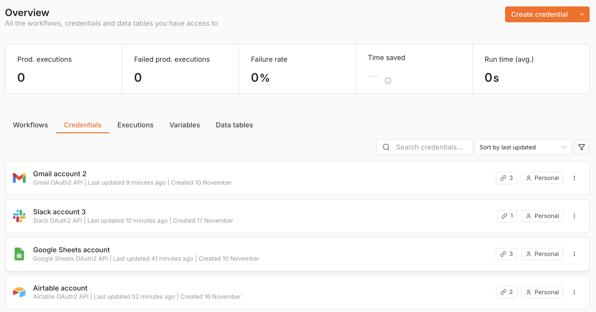

# Checkpoint 4 · Freebag — Integraciones Avanzadas e Interconexión de Sistemas

**Alumno:** Santos Tedin · **Curso:** AI Automation Avanzado (Coderhouse) · **Proyecto integrador:** Freebag

Freebag es un marketplace argentino que conecta marcas con freelancers creativos. Este checkpoint conecta el sistema multi-agente de los módulos anteriores (Manager-Worker del M2 + memoria persistente del M3) con **tres herramientas externas reales**, autenticadas por **OAuth2**:

| Rol | Herramienta | Uso | Operaciones |
|---|---|---|---|
| Casilla de correo | **Gmail** | Recibe los mails de marcas y creativos | Lectura: trigger de no leídos · Escritura: **solo Create Draft** |
| CRM | **Airtable · base `Freebag CRM`, tabla `Contactos`** | Fuente única de verdad de marcas y freelancers | Lectura: search por email · Escritura: Update o Create de contacto |
| Canal del equipo | **Slack** (`#freebag-operaciones`) | Observabilidad y alertas al equipo | Escritura: mensaje de texto plano |

> **¿Por qué Airtable como CRM?** La consigna aclara que *"lo que importa es el rol de cada pieza, no la marca"* y que se pueden usar *"las que tengas a mano mientras respeten el mismo rol"*. Airtable es la herramienta que Freebag ya usa para sus datos. La tabla `Contactos` cumple el rol de CRM: guarda quién es cada marca o freelancer, su tipo, el estado del lead y la última interacción. La conexión se hace por **OAuth2**, con scopes acotados.

Además se usa **Google Sheets** (planilla `Briefs Freebag`, pestañas `Memoria` y `Log`) para la memoria del M3 y la trazabilidad.

## Credenciales activas (las 3 herramientas por OAuth2 + Sheets)



Gmail OAuth2 API · Slack OAuth2 API · Airtable OAuth2 API · Google Sheets OAuth2 API. El modelo (Gemini) usa API key.

## Flujo

```
[Gmail Trigger] → ① IF ¿auto-reply? ──Sí──▶ Stop
                        │ No
                        ▼
                  ④ Set limpiar (From, Subject, BodyText) → IF ¿payload válido? ──No──▶ Slack (alerta)
                        │ Sí
                        ▼
                  AI Triage (Gemini · taxonomía cerrada BRIEF / FREELANCER / UNKNOWN)
                        ▼
                  ② Airtable Look up ──existe──▶ Update
                                     └─no─────▶ Create
                        ▼
                  Memoria M3 (Sheets) → ¿HITL? → Switch → Worker Briefs / Worker Freelancers (M2)
                        ▼
                  Contador + Summarizer (≥5 mensajes) → Guardar memoria + Log
                        ▼
                  ③ Gmail Create Draft (HITL) → Set payload mínimo → Slack
```

## Guardrails que evalúa la rúbrica

| # | Nodo | Qué previene | Configuración |
|---|---|---|---|
| ① | `IF - ¿Es auto-reply?` | El bucle infinito de auto-respuestas | Va inmediatamente después del trigger, en modo **OR**: el asunto contiene `Auto-reply`, `Out of office`, `Undeliverable` o `Respuesta automática`, o el remitente contiene `no-reply@`, `noreply@` o `mailer-daemon@`. Si se cumple → `Stop` |
| ② | `Airtable - Look up contacto` | El **error 409** (contactos duplicados) | Busca por email antes de escribir. Si existe → Update, si no → Create |
| ③ | `Gmail - Create Draft (HITL)` | Que salga un mail sin aprobación humana | La respuesta queda en Borradores, en el mismo hilo, para que una persona la revise y la envíe |
| ④ | `Set - Limpiar y validar payload` + `IF ¿Payload válido?` | El **error 400** y el exceso de datos | Deja solo `From`, `Subject` y `BodyText` (sin HTML, firmas ni metadatos, cuerpo truncado a 2000 caracteres) y valida que el email tenga formato correcto y que el cuerpo no esté vacío |
| — | `Set - Payload mínimo Slack` | Saturar el canal | Arma un único campo `text` antes de Slack |

## Mínimo privilegio

- **Airtable · scopes OAuth2:** solo `data.records:read`, `data.records:write` y `schema.bases:read`, con acceso a la base `Freebag CRM` y nada más.
- **Airtable · lectura:** el Look up devuelve solo `email`, `nombre`, `empresa` y `estado_lead`.
- **Airtable · escritura:** solo los campos de la tabla `Contactos`.
- **Gmail:** no hay ningún nodo con la operación Send. El agente solo crea borradores.
- **Slack:** publica únicamente en `#freebag-operaciones`.

## Cómo importarlo

1. En n8n: **Workflows → Import from File** → `checkpoint4_santos_tedin.json`.
2. Asignar las credenciales OAuth2 de Gmail, Airtable, Slack y Google Sheets, y la API key de Gemini.
3. En los nodos de Airtable, elegir la base `Freebag CRM` y la tabla `Contactos`, que tiene los campos `email | nombre | empresa | tipo | estado_lead | ultimo_asunto | ultima_interaccion`.
4. En `Ejecutar Worker Briefs` y `Ejecutar Worker Freelancers`, elegir los sub-workflows del M2 (`M2 - Worker Briefs` y `M2 - Worker Freelancers`).
5. En los nodos de Google Sheets, elegir la planilla con las pestañas:
   - `Memoria`: `session_id | user_name | fecha_actualizacion | resumen_consolidado | estado_caso | datos_clave | contador_mensajes`
   - `Log`: `timestamp | session_id | intent | confidence | risk | worker | status | requires_human | human_decision`

## Pruebas de regresión

| Caso | Mail de prueba | Resultado esperado |
|---|---|---|
| Brief nuevo | "Hola, soy Juli de Mila Indumentaria. Necesitamos fotos de producto para 20 prendas, presupuesto USD 400" | Create en Airtable + Worker Briefs + borrador + Slack 📩 |
| Mismo remitente otra vez | Otro mail desde la misma casilla | **Update** (no se duplica) + contexto de memoria |
| Freelancer | "Soy ilustradora, quiero sumarme a Freebag, mi portfolio es…" | Worker Freelancers + borrador |
| Auto-reply | Asunto "Out of office" | Se corta en `Stop`: no hay borrador ni CRM |
| Caso de riesgo | "Quiero un reembolso, voy a hacer un reclamo legal" | Fallback HITL + Slack ⚠️ REQUIERE HUMANO |

## Resultado de la prueba real (ejecución #63 · Succeeded)

Se procesó un mail no leído de la casilla (una promo de `store-news@amazon.com`):

| Paso | Resultado |
|---|---|
| ① IF auto-reply | No es auto-reply → sigue |
| ④ Set + validación | Payload limpio y válido |
| AI Triage (Gemini) | `intent: UNKNOWN` · `risk: LOW` → correcto: no es ni brief ni freelancer |
| ② Look up Airtable | No existe → **Create** de contacto en `Freebag CRM / Contactos` |
| ¿Requiere HITL? | Sí (UNKNOWN) → **Fallback HITL** |
| ③ Create Draft | Borrador de respuesta en Gmail, en el mismo hilo, sin enviar |
| Slack | Mensaje en `#freebag-operaciones`: *⚠️ REQUIERE HUMANO · CRM: contacto nuevo creado · Borrador listo en Gmail* |

A partir de esa prueba se agregó al trigger el filtro `-category:promotions -category:social -category:updates` para no gastar tokens en newsletters.
